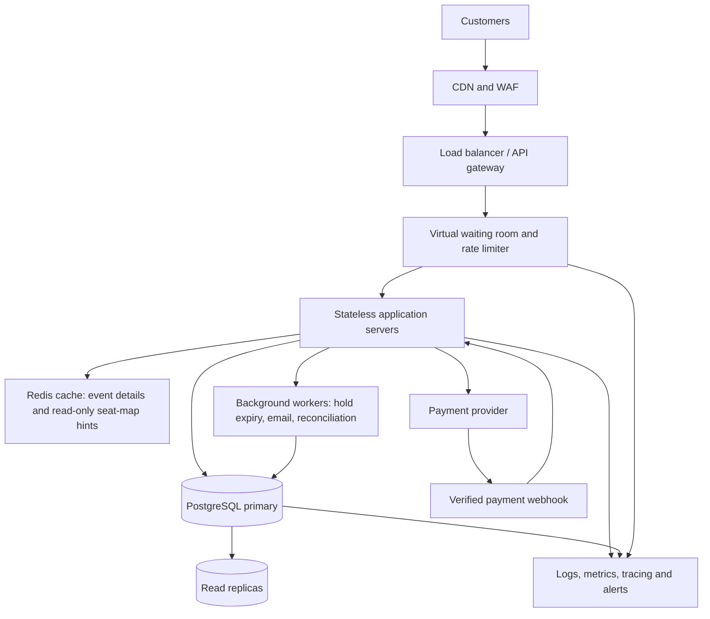

# TicketHub: Event Ticketing System Design

**Project:** Day 8 Capstone  
**Repository folder:** `day8/`  
**Status:** Proposed design  
**Primary concern:** Sell a limited number of event seats fairly and without double-booking.

## 1. Context, goals and requirements

TicketHub lets registered users discover events, view seat availability, reserve seats temporarily, pay, and retrieve tickets. The system has 2 million registered users.

### Goals

- Let users browse events and inspect a seat map.
- Allow a user to hold available seats for a limited time and complete payment.
- Never sell the same seat twice or sell more seats than an event contains.
- Remain responsive during a high-demand concert sale.
- Give users clear outcomes when seats are unavailable, a hold expires, or payment fails.

### Non-goals for this version

- Resale and ticket transfers between users.
- Dynamic pricing, loyalty programmes, and recommendations.
- Multiple currencies or multiple payment providers. The design uses one payment-provider integration but keeps it behind an adapter.

### Functional requirements

1. Users can register/sign in and view events.
2. Users can view a venue's seats and their current availability.
3. An authenticated user can hold one or more available seats for a short period (for example, 8 minutes).
4. A user can pay for an active hold and receive confirmed tickets.
5. A user can view their orders and tickets.
6. The system expires abandoned holds and releases their seats.
7. The system reports understandable errors for unavailable seats, expired holds, invalid requests, and failed payments.

### Non-functional requirements

- **Correctness:** a seat can have at most one active hold or completed sale at a time. No overselling is allowed.
- **Performance:** normal event and seat-map reads should target p95 under 300 ms; hold requests should target p95 under 500 ms when the sale is healthy. Payment-provider latency is external and is measured separately.
- **Availability:** target 99.9% monthly availability for browsing and ticket retrieval. During a sale, booking correctness takes priority over accepting every request.
- **Fairness:** use a virtual waiting room during a major sale, issue queue tokens, and admit users at a controlled rate. A queue improves orderliness but does not itself guarantee seat uniqueness.
- **Security:** authenticate users, authorise every order/ticket access, validate input, rate-limit abuse, protect payment credentials by using the provider's hosted/tokenised payment flow, and never store raw card details.
- **Durability and recovery:** confirmed orders must survive an application-server restart; backups and tested restore procedures are required.
- **Observability:** monitor request rate, latency, error rate, queue length, hold conflicts, payment outcomes, database connections, and seat inventory.

## 2. Scale estimates

These are planning estimates, not measurements. One day is approximated as 86,400 seconds. Actual traffic is bursty, so averages alone are not enough.

### Normal day

| Measure | Calculation | Estimate |
|---|---|---:|
| Registered users | Given | 2,000,000 |
| Daily visitors | Given | 50,000 |
| Page views per day | 50,000 visitors × 10 pages | 500,000 |
| Average page requests per second | 500,000 ÷ 86,400 | 5.8 requests/s |
| Planning peak for page requests | Assume 10× daily average | About 60 requests/s |
| Tickets sold per day | Given | 5,000 |
| Average ticket sales per second | 5,000 ÷ 86,400 | 0.058 tickets/s, or about 1 every 17 seconds |

The 60 requests/s figure is a simple 10× peak assumption. It is not a guarantee; access logs should replace this assumption as soon as measurements are available.

### Popular concert sale

200,000 people try to buy 20,000 seats in the first 10 minutes.

- **Average arrival rate:** 200,000 ÷ 600 seconds ≈ **333 people/attempts per second**.
- **Demand-to-supply ratio:** 200,000 ÷ 20,000 = **10 people competing for each seat on average**.
- **Potential seat demand:** 200,000 attempts, but only 20,000 seats can be sold. Most customers must receive an unavailable-seat result or wait for a hold to expire.
- **Planning capacity:** design the waiting room and application tier to absorb a short burst of around **1,000–1,700 incoming requests/s** (roughly 3–5× the 333/s average). This is a capacity target to validate with load tests, not a measured prediction.

The sale's arrival rate is about 57 times the normal day's average page-request rate (333 ÷ 5.8), before accounting for each person making multiple requests. The most sensitive path is seat holding and checkout, not ordinary browsing. The waiting room smooths arrivals; the database enforces the final booking decision.

## 3. REST API design

All endpoints use HTTPS. JSON is used for request and response bodies except for a successful payment-provider redirect/callback. Authentication uses a secure session or short-lived access token. IDs are illustrative.

| Method and endpoint | Purpose | Success response | Important error responses |
|---|---|---|---|
| `GET /api/events?date=&q=&page=` | Browse/search events with pagination | `200 OK` | `400 Bad Request` |
| `GET /api/events/{eventId}` | Get event details | `200 OK` | `404 Not Found` |
| `GET /api/events/{eventId}/seats` | Get seat map and current availability | `200 OK` | `404 Not Found` |
| `POST /api/holds` | Atomically hold selected seats | `201 Created` | `409 Conflict` if any seat is unavailable; `422 Unprocessable Content` for invalid selection |
| `POST /api/orders/{orderId}/payment-intent` | Start payment for a valid held order | `200 OK` or `201 Created` | `404 Not Found`, `409 Conflict`, `422 Unprocessable Content` |
| `POST /api/payments/webhook` | Receive signed provider payment result | `200 OK` after safely recording/queuing event | `400 Bad Request` for invalid signature/payload |
| `GET /api/me/orders` | List the signed-in user's orders | `200 OK` | `401 Unauthorized` |
| `GET /api/me/tickets` | List confirmed tickets for the signed-in user | `200 OK` | `401 Unauthorized` |

### Example: hold seats

Request:

```http
POST /api/holds
Content-Type: application/json
Idempotency-Key: 2c1f4d5e-unique-client-key
Authorization: Bearer <access-token>
```

```json
{
  "eventId": "evt_204",
  "seatIds": ["seat_A12", "seat_A13"]
}
```

Successful response (`201 Created`):

```json
{
  "holdId": "hold_8301",
  "orderId": "ord_7204",
  "status": "HELD",
  "expiresAt": "2026-10-11T12:08:00Z"
}
```

If either seat has already been held or sold, return `409 Conflict` and do not leave a partial hold behind. The client can refresh the seat map and choose again. The idempotency key helps prevent duplicate holds when a client retries after a timeout.

### Example: payment outcome

A payment-provider webhook must be signature-verified and processed idempotently. A successful payment changes the order to `CONFIRMED` and the seats to `SOLD` in a database transaction. A failed or timed-out payment must not create confirmed tickets. Payment callbacks can be retried, so a repeated callback must not create another order or sell a seat again.

## 4. Data model

Use a relational database such as PostgreSQL as the source of truth for inventory, holds, orders, and payment state. Foreign keys and constraints protect relationships; indexes support the busiest queries.

### Tables and relationships

1. **users** — one user can place many orders.
2. **events** — one event has many seats and orders.
3. **seats** — each seat belongs to one event and can be sold at most once for that event.
4. **orders** — each order belongs to one user and one event; it tracks the hold/checkout lifecycle.
5. **order_items** — connects orders to specific seats and records the price agreed at checkout.
6. **payments** — records provider payment attempts and their unique provider reference.

```sql
CREATE TABLE users (
  id            BIGINT GENERATED ALWAYS AS IDENTITY PRIMARY KEY,
  email         TEXT NOT NULL UNIQUE,
  password_hash TEXT NOT NULL,
  created_at    TIMESTAMPTZ NOT NULL DEFAULT CURRENT_TIMESTAMP
);

CREATE TABLE events (
  id          BIGINT GENERATED ALWAYS AS IDENTITY PRIMARY KEY,
  title       TEXT NOT NULL,
  venue       TEXT NOT NULL,
  starts_at   TIMESTAMPTZ NOT NULL,
  status      TEXT NOT NULL DEFAULT 'ON_SALE'
              CHECK (status IN ('DRAFT', 'ON_SALE', 'SOLD_OUT', 'CANCELLED')),
  created_at  TIMESTAMPTZ NOT NULL DEFAULT CURRENT_TIMESTAMP
);

CREATE TABLE seats (
  id              BIGINT GENERATED ALWAYS AS IDENTITY PRIMARY KEY,
  event_id        BIGINT NOT NULL REFERENCES events(id),
  seat_label      TEXT NOT NULL,
  price_cents     INTEGER NOT NULL CHECK (price_cents >= 0),
  status          TEXT NOT NULL DEFAULT 'AVAILABLE'
                  CHECK (status IN ('AVAILABLE', 'HELD', 'SOLD')),
  hold_order_id   BIGINT,
  hold_expires_at TIMESTAMPTZ,
  UNIQUE (event_id, seat_label),
  CHECK (
    (status = 'HELD' AND hold_order_id IS NOT NULL AND hold_expires_at IS NOT NULL)
    OR
    (status <> 'HELD' AND hold_order_id IS NULL AND hold_expires_at IS NULL)
  )
);

CREATE TABLE orders (
  id          BIGINT GENERATED ALWAYS AS IDENTITY PRIMARY KEY,
  user_id     BIGINT NOT NULL REFERENCES users(id),
  event_id    BIGINT NOT NULL REFERENCES events(id),
  status      TEXT NOT NULL
              CHECK (status IN ('PENDING', 'HELD', 'PAYMENT_PENDING',
                                'CONFIRMED', 'EXPIRED', 'CANCELLED', 'FAILED')),
  total_cents BIGINT NOT NULL CHECK (total_cents >= 0),
  expires_at  TIMESTAMPTZ,
  created_at  TIMESTAMPTZ NOT NULL DEFAULT CURRENT_TIMESTAMP
);

ALTER TABLE seats
  ADD CONSTRAINT seats_hold_order_fk
  FOREIGN KEY (hold_order_id) REFERENCES orders(id);

CREATE TABLE order_items (
  id             BIGINT GENERATED ALWAYS AS IDENTITY PRIMARY KEY,
  order_id       BIGINT NOT NULL REFERENCES orders(id),
  seat_id        BIGINT NOT NULL REFERENCES seats(id),
  unit_price_cents INTEGER NOT NULL CHECK (unit_price_cents >= 0),
  status         TEXT NOT NULL DEFAULT 'ACTIVE'
                 CHECK (status IN ('ACTIVE', 'CANCELLED', 'REFUNDED')),
  UNIQUE (order_id, seat_id)
);

-- A seat may appear in only one active or completed order item.
-- Cancelled/refunded items no longer block a future legitimate sale.
CREATE UNIQUE INDEX one_live_order_item_per_seat
  ON order_items(seat_id)
  WHERE status = 'ACTIVE';

CREATE TABLE payments (
  id                    BIGINT GENERATED ALWAYS AS IDENTITY PRIMARY KEY,
  order_id              BIGINT NOT NULL REFERENCES orders(id),
  provider_reference    TEXT NOT NULL UNIQUE,
  idempotency_key       TEXT NOT NULL UNIQUE,
  amount_cents          BIGINT NOT NULL CHECK (amount_cents >= 0),
  status                TEXT NOT NULL
                        CHECK (status IN ('PENDING', 'SUCCEEDED', 'FAILED', 'REFUNDED')),
  created_at            TIMESTAMPTZ NOT NULL DEFAULT CURRENT_TIMESTAMP
);

CREATE INDEX events_start_time_idx ON events(starts_at);
CREATE INDEX seats_event_status_idx ON seats(event_id, status);
CREATE INDEX orders_user_created_idx ON orders(user_id, created_at DESC);
CREATE INDEX payments_order_idx ON payments(order_id);
```

**Relationship summary:** `users 1—many orders`; `events 1—many seats`; `events 1—many orders`; `orders 1—many order_items`; `seats 1—many historical order_items` but the partial unique index permits only one `ACTIVE` item per seat; `orders 1—many payment attempts`.

The schema is a starting point. In production, seat-state transitions and order-item state changes must be performed only through controlled transactional service code. The application should also validate that every seat in an order belongs to that order's event.

## 5. Preventing two people from buying the same seat

**The database, not the seat-map cache or waiting room, is the final authority.** The hold operation must be atomic and must not check availability in one query and update later without locking.

A safe hold flow is:

1. Begin a database transaction.
2. Lock the requested seat rows in a consistent order (for example, sorted by seat ID) using `SELECT ... FOR UPDATE`.
3. Verify every requested seat belongs to the requested event and is either `AVAILABLE` or has a genuinely expired hold.
4. Create the order/hold and update all selected seats from `AVAILABLE` to `HELD`, setting `hold_order_id` and `hold_expires_at`.
5. If any seat cannot be acquired, roll back the entire transaction and return `409 Conflict`. Do not hold only some of the requested seats.
6. Commit the transaction. Only after commit should the API report a successful hold.

The row locks make competing transactions wait; after the first transaction commits, the second transaction sees that the seat is no longer available. A conditional update such as `UPDATE seats SET status = 'HELD' ... WHERE id = ? AND status = 'AVAILABLE'` must also check the number of rows affected. A unique constraint on `(event_id, seat_label)` prevents duplicate seat records, while the partial unique index on active order items prevents the same seat from being attached to two live orders. These controls complement each other.

**Hold expiry:** a scheduled worker finds expired holds and releases them transactionally, but the hold endpoint must also treat an expired hold as reclaimable; correctness must not depend on a background job running at the exact second. The worker must confirm the seat is still held by that same expired order before releasing it.

**Payment race:** do not hold a database transaction open while waiting for an external payment provider. Keep the hold until its expiry while payment is pending, use provider idempotency keys, and process verified callbacks idempotently. In a short database transaction, confirm the order and mark its seats `SOLD` only if the order still owns valid holds. If the hold expired and another customer acquired a seat, do not confirm the old order; initiate the documented compensation/refund flow. For high reliability, record payment events in a durable inbox/outbox and reconcile uncertain provider outcomes.

The seat map and Redis cache are read optimisations only. They may briefly display stale availability, so the hold endpoint always rechecks the database and can reject a seat that looked available a moment earlier.

## 6. High-level architecture and how it handles a big sale



### Component responsibilities

- **CDN and WAF:** cache static assets, reduce latency for images/CSS/JavaScript, and filter common malicious traffic. Do not cache personalised checkout or payment responses.
- **Load balancer/API gateway:** distribute requests across healthy app servers, terminate TLS, enforce request limits, and route traffic.
- **Virtual waiting room/rate limiter:** queue excess sale traffic and admit a controlled number of users. Issue signed, short-lived queue tokens; apply per-account and per-IP limits without treating IP alone as identity.
- **Stateless app servers:** validate requests and run business logic. Sessions live in a shared store or signed tokens, not server-local memory, so any healthy server can handle the next request.
- **Redis:** speed up event-detail reads and seat-map hints. It is not authoritative for inventory and must never be used alone to decide who owns a seat.
- **PostgreSQL primary:** serialises competing seat claims with transactions/row locks and enforces constraints. All hold and sale decisions go here.
- **Read replicas:** serve suitable browse/event queries to reduce primary read load. Replication can lag, so checkout and seat-hold decisions must not rely on replica results.
- **Payment provider and webhook:** handle payment securely; verified, idempotent webhook processing updates order state.
- **Background workers:** expire holds, send confirmations, reconcile uncertain payments, and retry safe asynchronous work.
- **Monitoring and alerting:** observe queue depth, p95/p99 latency, 409 conflict rates, database lock waits, connection-pool saturation, payment failures, and error rates.

### Big-sale operating plan

1. Warm event and static content caches before the sale opens.
2. Use the waiting room to smooth the 200,000-person rush and admit traffic at the tested safe rate.
3. Autoscale stateless app servers, while keeping database connection pools bounded. More app servers must not create unlimited database connections.
4. Keep browse traffic on caches/read replicas where appropriate, but route all seat holds and final confirmations to the primary database.
5. Load-test realistic contention for the same seats, payment timeouts, retry storms, and hold expiries before the sale. Set a maximum active hold per user and limit seats per order.
6. If the database becomes unhealthy, stop or slow new admissions rather than acknowledge unsafe bookings. Show a clear queue/temporary-unavailable message and allow safe retries with idempotency keys.

The 1,000–1,700 requests/s planning range should be validated in a staging load test. The database's ability to handle highly contended seat updates is likely to be a more important limit than serving cached event pages.

## 7. Trade-offs and alternatives considered

### Trade-off 1: Strict database transactions vs. accepting more requests

- **Choice:** use PostgreSQL transactions, row locks, conditional updates, and unique constraints for seat inventory.
- **Benefit:** strong correctness; two customers cannot successfully acquire the same seat through concurrent requests.
- **Cost:** lock contention can increase latency during the hottest seconds of a sale.
- **Alternative:** keep inventory only in Redis for faster operations. Rejected as the sole authority because cache loss, race conditions, or incorrect scripts could risk overselling. Redis can assist with queueing, but the database remains authoritative.

### Trade-off 2: Waiting room vs. letting every request reach the application

- **Choice:** queue and rate-limit traffic during high-demand sales.
- **Benefit:** protects the application and database, reduces overload, and gives users a more orderly experience.
- **Cost:** customers wait and some may abandon the queue; queue position is not a promise that a desired seat will still be available.
- **Alternative:** admit all 200,000 customers immediately. Rejected because the sudden burst can exhaust connections and make the site fail for everyone.

### Trade-off 3: Read replicas and caching vs. always reading the primary

- **Choice:** use caches/replicas for browse traffic, but the primary for all inventory-changing decisions.
- **Benefit:** lower read load and faster browsing.
- **Cost:** cached seat maps may be stale and replicas may lag, so the UI can show a seat that cannot actually be held.
- **Alternative:** read every page from the primary for freshest data. Simpler, but needlessly increases primary load. The final hold response is always authoritative.

### Trade-off 4: Temporary holds vs. immediate purchase-only checkout

- **Choice:** give a short, visible hold window (for example, 8 minutes).
- **Benefit:** users have time to complete payment without losing seats instantly.
- **Cost:** abandoned holds temporarily hide seats from other customers and require expiry/reconciliation logic.
- **Alternative:** no holds. This reduces expiry complexity but makes checkout stressful and can increase failed purchases. A short hold with clear countdown and reliable expiry is the better user experience.

## 8. Risks, open questions and monitoring

- **Payment outcome is uncertain:** provider timeouts may occur after a charge. Use idempotency, signed webhooks, reconciliation, and a documented refund/compensation path.
- **Hot-seat contention:** a few popular seats may receive many simultaneous attempts. Measure lock waits and conflict rates; test transactions under realistic contention.
- **Queue fairness:** decide whether queue order is first-come-first-served, randomised at sale start, or uses another published policy. Prevent refresh/reconnect from creating a new place in line.
- **Capacity assumptions:** confirm traffic patterns and database limits with load tests and production metrics.
- **Operations:** define backup/restore objectives, alert thresholds, incident procedures, and how cancelled events/refunds are handled.

Key dashboards: request volume and p95/p99 latency by endpoint; queue depth and wait time; hold success/conflict/expiry rates; number of seats in each state; payment success/failure/unknown outcomes; database CPU, connections, locks and replication lag; and application error rate.

## Conclusion

TicketHub scales by separating high-volume browsing from inventory-changing operations. Caches, replicas, a waiting room, and stateless app servers absorb traffic, but the core correctness guarantee comes from atomic database transactions and constraints. The design deliberately prefers a correct, explainable booking result over accepting a request that might double-sell a seat.
